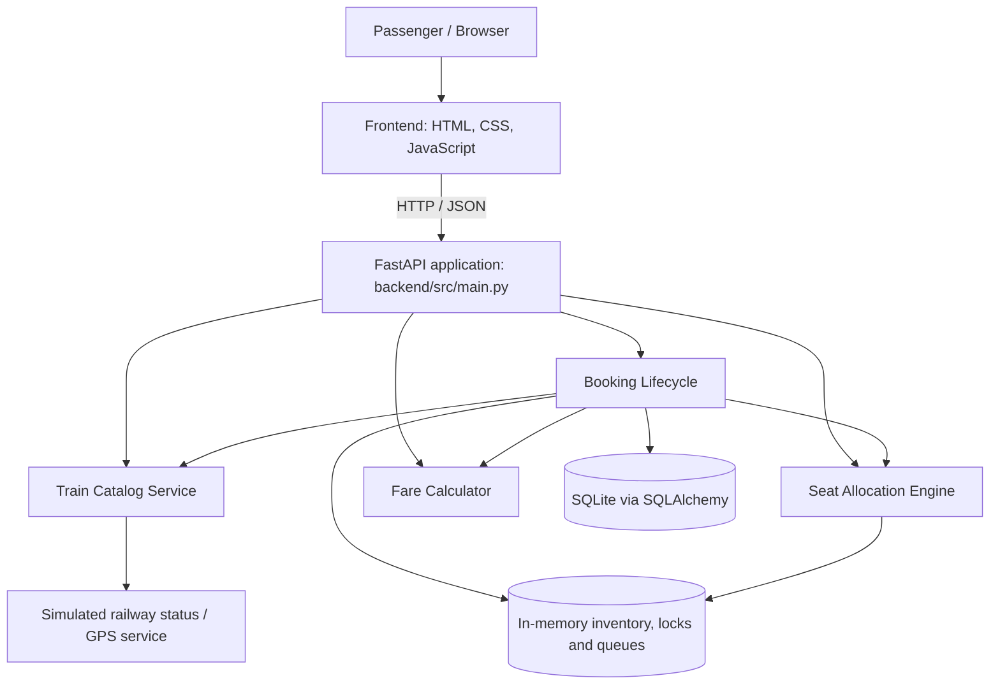

# Railway Reservation System — IRCTC Connect

A full-stack railway reservation application developed as a Software Engineering mini-project (Topic 74 — Jackfruit). The project demonstrates train discovery, route search, berth allocation, temporary seat locking, fare calculation, passenger booking, PNR lookup, cancellation, and RAC/wait-list promotion through a modular REST backend and browser-based frontend.

> **Project scope:** This is an academic demonstration system. Railway schedules, fares, concessions, running status, GPS telemetry, payments, and PNRs are locally modelled or simulated. It is not an official IRCTC service and does not issue valid Indian Railways tickets.

---

## Contents

- [Project at a glance](#project-at-a-glance)
- [Team and responsibilities](#team-and-responsibilities)
- [Features](#features)
- [Architecture](#architecture)
- [Repository structure](#repository-structure)
- [Technology stack](#technology-stack)
- [Getting started](#getting-started)
- [API overview](#api-overview)
- [Database and persistence](#database-and-persistence)
- [Testing and CI](#testing-and-ci)
- [Project documentation](#project-documentation)
- [Known limitations](#known-limitations)
- [Future work](#future-work)
- [Contributing](#contributing)
- [License](#license)

---

## Project at a glance

| Item | Details |
| --- | --- |
| Project | Railway Ticket Reservation System |
| Project label | Topic 74 — Jackfruit |
| Course | Software Engineering Mini-Project (UE24CS341A) |
| Active Phase | Sprint 2 Active (8 User Stories, 36 Story Points) |
| Backend | Python, FastAPI, Uvicorn |
| Frontend | React 19, Tailwind CSS, Vite, Lucide Icons |
| Persistence | SQLite 3 (`data/railway.db`) with SQLAlchemy models & Node 22 SQLite driver |
| Testing | pytest, FastAPI TestClient, pytest-cov (84/84 passing) |
| Local API | `http://localhost:8000` |
| Express Server | `http://localhost:5000` (Persistence & Email Gateway) |
| API documentation | `http://localhost:8000/docs` |
| Frontend dev server | Vite, typically `http://localhost:5173` |

## Team and responsibilities

The project is divided into four domain modules so each contributor can develop and test a well-defined part of the reservation workflow. Names and responsibilities below are taken from the project documentation and feature-specific commit history.

| Team member | GitHub | Module ownership | Main responsibilities |
| --- | --- | --- | --- |
| **Rahul Shenoy** | [@rahulsheno](https://github.com/rahulsheno) | Booking lifecycle and integration | Booking orchestration, PNR generation and lookup, cancellation workflow, RAC/WL promotion, unified FastAPI gateway, frontend integration, CI and SDLC documentation |
| **Sabbir Mondal** | [@SabbirMondal314159](https://github.com/SabbirMondal314159) | Train catalog and railway services | Station and train catalog, route search, schedules and halts, station facilities, simulated NTES running status and GPS telemetry |
| **Samvit Atur** | [@samvitOK](https://github.com/samvitOK) | Seat allocation and concurrency | Coach/berth layout generation, seat inventory, temporary locks, lock renewal/release, group allocation, RAC and waiting-list queues |
| **Vinayak Kalal** | [@kalalvinayak23](https://github.com/kalalvinayak23) | Fare and refund engine | Distance/class fare calculation, project-configured concessions, quota and superfast surcharges, GST calculation, cancellation refunds and invoice generation |

### Recorded Sprint Contribution Summary

#### Sprint 1 (Concluded & Signed Off)
| Member | Story points from listed rows | Tests recorded in sign-off | Subsystem Focus |
| --- | ---: | ---: | --- |
| Sabbir Mondal | 16 | 17 | Train Catalog & Live Tracking |
| Samvit Atur | 16 | 17 | Coach Layout & Seat Allocation |
| Vinayak Kalal | 16 | 18 | Dynamic Fare Engine & Concessions |
| Rahul Shenoy | 18 | 32 | Booking Lifecycle, Architecture & CI/CD |
| **Total from listed rows** | **66** | **84** | **100% Pass Rate** |

#### Sprint 2 (Active Implementation)
See [`docs/06_SPRINT_2_BACKLOG.md`](docs/06_SPRINT_2_BACKLOG.md) and [`docs/jira_import_ready.csv`](docs/jira_import_ready.csv) for full acceptance criteria.

| Member | Jira Stories | Story Points | Deliverables |
| --- | --- | ---: | --- |
| **Sabbir Mondal** | RRS-17, RRS-18 | 8 | IST timezone normalization, quick-date search, and live satellite GPS radar |
| **Samvit Atur** | RRS-19, RRS-20 | 8 | Interactive 2D coach visualizer (1A, 2A, 3A, EC, SL), senior priority & catering |
| **Vinayak Kalal** | RRS-21, RRS-22 | 10 | Automated PRS departure countdown clock, 4-tier refund policy & audit log |
| **Rahul Shenoy** | RRS-23, RRS-24 | 10 | ACID SQLite 3 models, client-server dual-layer persistence (localStorage + sync) |
| **Total Sprint 2** | **8 User Stories** | **36** | **2 Stories per Student (Equal Distribution)** |

---

## Features

### 1. Train catalog and route search

- Browse seeded station and train data.
- Search trains between source and destination stations.
- Validate route direction and intermediate halts.
- Inspect train schedules, distances and stop information.
- View station facilities and amenities.
- Access simulated train running status and GPS-style telemetry.

### 2. Coach layout and seat allocation

- Generate berth layouts for Sleeper, 3A, 2A, 1A, CC and EC classes.
- Track seats as `AVAILABLE`, `LOCKED` or `BOOKED`.
- Apply berth preferences where a matching berth is available.
- Temporarily lock a selected seat for five minutes.
- Renew or explicitly release a lock.
- Attempt contiguous seat allocation for group bookings.
- Add passengers to configured RAC and waiting-list queues when confirmed inventory is exhausted.

### 3. Fare calculation

The fare engine uses project-configured class rates and minimum fares, then applies the configured concession, quota, superfast and tax rules. It returns an itemised fare breakdown.

The values and policies are illustrative application rules. They should not be interpreted as the current official Indian Railways tariff or eligibility policy.

### 4. Booking and PNR lifecycle

- Validate train, source, destination and passenger input.
- Allocate a seat or queue position for each passenger.
- Calculate passenger fares and booking total.
- Simulate payment processing.
- Generate a unique ten-digit project PNR.
- Retrieve booking details and user booking history.
- Cancel a booking and calculate the configured refund.
- Promote queued passengers when a confirmed seat is released.

### 5. Frontend experience

The repository includes a modern, responsive single-page application built with **React 19, Tailwind CSS, Vite, and Lucide Icons**. The frontend source is located in `src/` (with modular dialogs and screens in `src/components/`, multilingual contexts in `src/context/`, and client services in `src/services/`). It includes interactive train search, 2D coach visualizer, live satellite GPS radar tracking, automated countdown cancellation dialogs, and instant e-ticket reservation slips.

---

## Architecture

The backend follows a **modular monolith** design. A single FastAPI application exposes REST endpoints and delegates domain operations to four separately organised services.



### Booking flow

1. The passenger searches for a train and route.
2. The frontend requests train and schedule data from the catalog API.
3. The passenger selects a class and berth/seat.
4. The seat engine checks availability and can create a temporary lock.
5. The booking request reaches the booking lifecycle service.
6. The booking service validates the route, requests seat allocation and calculates each passenger's fare.
7. The payment operation is simulated and a PNR is generated.
8. Booking details are returned and, when persistence is enabled and succeeds, stored through SQLAlchemy.
9. A PNR lookup retrieves the booking; cancellation invokes the refund logic and queue-promotion workflow.

### Main backend modules

| Module | Main source | Responsibility |
| --- | --- | --- |
| API gateway | `backend/src/main.py` | FastAPI app, request schemas, endpoints and service wiring |
| Train catalog | `backend/src/train_service/catalog.py` | Stations, trains, routes, schedules, facilities and simulated status |
| Seat engine | `backend/src/seat_engine/allocator.py` | Coach layout, inventory, locks, allocation, RAC/WL queues |
| Fare engine | `backend/src/fare_calculator/calculator.py` | Fare components, concessions, surcharges, GST and refunds |
| Booking lifecycle | `backend/src/booking_lifecycle/lifecycle.py` | Booking, PNR, persistence, cancellation and queue promotion |
| Database models | `backend/src/database/models.py` | SQLAlchemy table definitions |
| Database setup | `backend/src/database/init_db.py` | Create tables and seed station/train catalog |

---

## Repository structure

```text
74_JACKFRUIT--SE-MINI-Railway-Reservation-System/
├── .github/workflows/ci.yml
├── backend/
│   ├── src/
│   │   ├── booking_lifecycle/lifecycle.py
│   │   ├── database/
│   │   │   ├── db_session.py
│   │   │   ├── init_db.py
│   │   │   ├── models.py
│   │   │   └── seed_data.py
│   │   ├── fare_calculator/
│   │   ├── seat_engine/
│   │   ├── train_service/
│   │   └── main.py
│   └── tests/
├── data/
│   └── railway.db
├── public/
│   ├── destinations/
│   └── train-logo-centered.png
├── scripts/
│   └── generate_jira_csv.py
├── server/
│   ├── hashDb.js
│   └── sqliteDb.js
├── src/
│   ├── components/
│   ├── context/
│   ├── data/
│   ├── i18n/
│   ├── services/
│   ├── App.jsx
│   ├── index.css
│   └── main.jsx
├── .env.example
├── .gitignore
├── Dockerfile
├── docker-compose.yml
├── index.html
├── package.json
├── package-lock.json
├── requirements.txt
├── server.js
├── tailwind.config.js
├── vite.config.js
└── README.md
```

---

## Technology stack

| Area | Technology | Usage |
| --- | --- | --- |
| Backend framework | FastAPI | REST API and request validation |
| Backend language | Python | Domain services and business rules |
| Request models | Pydantic | Validate API payloads |
| ORM | SQLAlchemy | SQLite models and database sessions |
| Database | SQLite | Booking and cancellation persistence |
| Frontend | HTML5, CSS3, JavaScript | Browser UI and API calls |
| Frontend tooling | Vite, npm | Local frontend development and build |
| Testing | pytest | Unit and API tests |
| API testing | FastAPI TestClient / httpx | Endpoint tests |
| Coverage | pytest-cov | Coverage reporting and CI threshold |
| Containerisation | Docker, Docker Compose | Container build and local service execution |
| CI | GitHub Actions | Automated test workflow |

---

## Getting started

### Prerequisites

- Python 3.11
- Node.js 18 or later and npm
- Git

### 1. Clone the repository

```bash
git clone https://github.com/rahulsheno/74_JACKFRUIT--SE-MINI-Railway-Reservation-System.git
cd 74_JACKFRUIT--SE-MINI-Railway-Reservation-System
```

### 2. Install backend dependencies

Create and activate a virtual environment:

```bash
python -m venv .venv
```

Activate the environment:

**Windows PowerShell**
```powershell
.\.venv\Scripts\Activate.ps1
```

**macOS / Linux**
```bash
source .venv/bin/activate
```

Install backend dependencies from [`requirements.txt`](requirements.txt):

```bash
python -m pip install --upgrade pip
python -m pip install -r requirements.txt
```

### 3. Initialise the SQLite database

```bash
python -m backend.src.database.init_db
```

This creates the configured `data/railway.db` database, creates the SQLAlchemy tables and seeds the station/train catalog if those tables are empty.

### 4. Start the backend

From the repository root:

```bash
python -m uvicorn backend.src.main:app --reload --host 127.0.0.1 --port 8000
```

The API is available at:

- Base URL: `http://127.0.0.1:8000`
- Swagger UI: `http://127.0.0.1:8000/docs`
- ReDoc: `http://127.0.0.1:8000/redoc`

### 5. Start the frontend

Open a second terminal at the repository root:

```bash
npm install
npm run dev
```

Vite prints the frontend URL when it starts; the default is usually `http://localhost:5173`.

> **Frontend integration note:** The backend mounts `dist/` when present and otherwise falls back to `frontend/`. The Vite dev server is a separate process. Confirm the API base URL used by the frontend and configure a Vite proxy or matching API URL if the browser reports CORS or connection errors.

### Build the frontend

```bash
npm run build
npm run preview
```

The production build is written to `dist/`, which the FastAPI application is configured to serve when that directory exists.

---

## API overview

The complete interactive API schema is available at `http://127.0.0.1:8000/docs` after starting FastAPI.

| Method | Endpoint | Description |
| --- | --- | --- |
| GET | `/api/stations` | List stations |
| GET | `/api/trains` | List trains |
| GET | `/api/trains/search` | Search trains by source, destination and optional date |
| GET | `/api/trains/{train_number}/schedule` | Get train schedule and status |
| GET | `/api/stations/{station_code}/facilities` | Get station amenities |
| GET | `/api/trains/{train_number}/live-tracking` | Get simulated GPS telemetry |
| GET | `/api/trains/{train_number}/running-status` | Get simulated running status |
| GET | `/api/seats/layout` | Get coach berth layout |
| GET | `/api/seats/availability` | Get seat availability summary |
| POST | `/api/seats/lock` | Lock a seat temporarily |
| DELETE | `/api/seats/unlock/{lock_id}` | Release a lock by lock ID |
| POST | `/api/seats/unlock` | Release a user's seat lock |
| POST | `/api/seats/lock/renew` | Renew a seat lock |
| GET | `/api/trains/{train_number}/occupancy` | Get coach occupancy breakdown |
| GET | `/api/fare/calculate` | Calculate a fare |
| GET | `/api/fare/refund-estimate` | Estimate a cancellation refund |
| POST | `/api/fare/eticket-invoice` | Generate an invoice response |
| POST | `/api/bookings` | Create a booking |
| GET | `/api/pnr/{pnr}` | Retrieve booking by PNR |
| GET | `/api/users/{user_id}/bookings` | Retrieve booking history for a user ID |
| POST | `/api/bookings/cancel` | Cancel a booking |

### Example: search trains

```bash
curl "http://127.0.0.1:8000/api/trains/search?source=SBC&destination=MAS"
```

### Example: calculate a fare

```bash
curl "http://127.0.0.1:8000/api/fare/calculate?distance_km=362&coach_class=SL&concession_type=NONE&quota=GENERAL"
```

### Example: inspect seat availability

```bash
curl "http://127.0.0.1:8000/api/seats/availability?train_number=12658&journey_date=2026-11-20&coach_class=3A"
```

For booking, cancellation and seat-lock operations, use the request schemas displayed in Swagger UI. Do not submit real identity or payment data to this demonstration application.

---

## Database and persistence

The database layer is configured in `backend/src/database/db_session.py` (FastAPI) and `server/sqliteDb.js` (Express). The shared SQLite 3 database file is:

```text
data/railway.db
```

The database schema defines the following relational tables:

| Table | Purpose |
| --- | --- |
| `stations` | Station code, name, zone and facilities |
| `trains` | Train details, route halts, classes and operating days |
| `bookings` | PNR, passenger payload, journey, fare and booking status |
| `cancellations` | Cancellation time, deductions and refund reference |
| `seat_locks` | Seat-lock metadata and expiration fields |
| `users` | Passenger profiles and hashed contact records |
| `tickets` | Full Electronic Reservation Slip (ERS) records with SHA-256 security hashes |

Station and train seed data is defined in `backend/src/database/seed_data.py` and loaded by `init_db.py`.

**Dual-layer persistence:** The system combines browser-level caching (`localStorage`) with backend SQLite 3 persistence (`/api/db/tickets` and `/api/db/sync-ticket`). When passengers refresh the page (F5), booked tickets and cancellation statuses are automatically fetched and restored from the SQLite database.

---

## Testing and CI

Run the backend test suite from the repository root:

```bash
python -m pytest backend/tests/ -v
```

Run with coverage:

```bash
python -m pytest backend/tests/ --cov=backend/src --cov-report=term-missing
```

The test files are organised by subsystem:

| Test file | Coverage focus |
| --- | --- |
| `test_api_endpoints.py` | REST routes and request/response behaviour |
| `test_train_service.py` | Station lookup, routes, schedules and simulated status |
| `test_seat_engine.py` | Berth generation, locking, allocation and queues |
| `test_fare_calculator.py` | Fare components, concessions and refund calculations |
| `test_booking_lifecycle.py` | Booking, PNR, cancellation and promotion logic |

The GitHub Actions workflow in `.github/workflows/ci.yml` is configured to install Python 3.11 dependencies, run pytest with coverage, enforce an 80% minimum coverage threshold and upload the HTML coverage report.

The Sprint 1 review document reports 84 passing automated tests. Check the Actions tab for the latest run before treating that number as the current build status.

---

## Known limitations

This repository is an educational prototype. Important limitations to keep in mind:

1. **No official IRCTC integration:** The project does not authenticate with IRCTC/CRIS or make authorised bookings.
2. **Simulated live information:** Running status, GPS coordinates, delays and platform information are generated by local service logic; they are not live railway telemetry.
3. **Simulated payment:** The payment workflow is not connected to a bank, UPI provider or payment gateway.
4. **In-memory seat state:** Inventory, locks and waiting queues are process-local. They are not safe as a shared source of truth across multiple application workers or instances.
5. **Concurrency needs hardening:** Seat locking requires a persistent, atomic mechanism and strict lock-owner validation before deployment. Do not use the current implementation for real reservations.
6. **Persistence error handling:** Database write failures should be surfaced and handled with rollback rather than silently ignored.
7. **Authentication and authorisation:** The API should gain proper user authentication, ownership checks and role-based permissions before exposing personal booking data.
8. **Fare-policy accuracy:** Configured rates, concessions, quotas, GST and refund rules are project logic, not a source of current official railway policy.
9. **Security configuration:** CORS is permissive in the current API development configuration and should be restricted to trusted frontend origins before production deployment.

---

