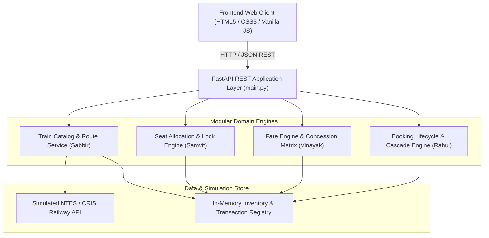
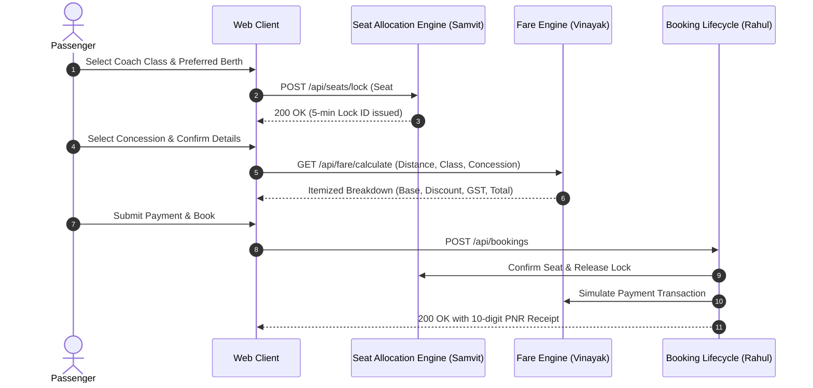
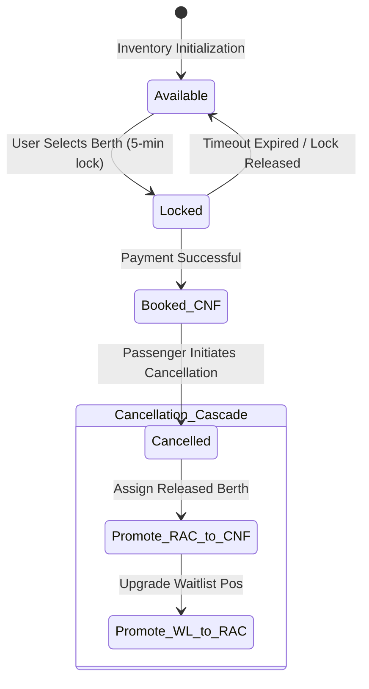

# System Architecture & Software Design Document
## Topic 74: Railway Ticket Reservation System
**Subject Code**: UE24CS341A • Jackfruit Phase-2 Deliverable

---

## 1. Modular High-Level Architecture (HLD)

---

## 2. Low-Level Design (LLD) & UML Sequence Flow

### Seat Lock & Booking Sequence Diagram

---

## 3. Cascade Cancellation State Machine

